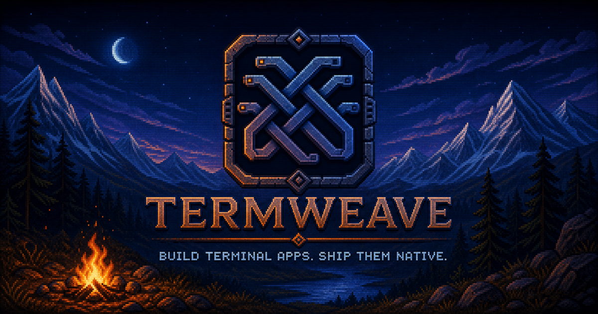

<div align="center">
  
</div>

📟 **Termweave** turns an OpenTUI + React interface into a native desktop app — running inside a real CRT monitor. You bring the vibes, termweave brings the machine.

**You write React — we handle:**

- 📦 The native window, terminal renderer, app lifecycle & packaging
- 📺 The whole CRT: bezel, tube optics, power-on click, ambient hum
- 🖼️ `PixelRenderer` — PNG/JPEG backdrops under your UI
- 🧊 `ThreeRenderer` — three.js scenes in the tube, RGB332-quantized like everything else
- 🪐 `SpaceObject` — proceduraly generated universe as a starter example
- ⚙️ One `app.config.json`: name, colors, bundle metadata
- 🔥 Live reload without restarting the window
- ⚡️ One command to a native `.app` + `.dmg`

## 🎯 Who is this for

- 🤖 **AI agents** that deserve a home screen, not a boring terminal
- 🕹️ **Retro games** that want to *feel* like 1998
- 🎬 **ThreeJS dataviz** people actually screenshot

## 🚀 Quick start

You need macOS, [Bun 1.3+](https://bun.sh/), [Rust](https://www.rust-lang.org/tools/install), and the Xcode Command Line Tools.

```sh
bun install
bun run dev
```

The monitor turns on. Press Ctrl+C in the window to quit. That's the whole tutorial. ✨

## 🎨 Make it yours

- `app/App.tsx` — your interface
- `app.config.json` — name, `themeColor`, bundle metadata
- `app.icon.png` — your icon

Edits under `app/` hot-reload. Change the config or icon → restart `bun run dev`.

## 📺 A real CRT, not a filter

This is the part that makes people go *"wait, what?"* — a monitor bezel around a live tube with physically calibrated optics:

- 🌀 Barrel curvature
- 🌈 Chromatic fringe
- ✨ Bloom & scanlines
- 🔊 The power-on click and a low hum

All rendered on the terminal's own GPU, never a canned overlay. Your `themeColor` repaints the whole machine — tube, bezel, glow.

## 🖼️ Pixel-art > text

```tsx
import { PixelRenderer } from "#termweave";
import bg from "./assets/bg.png" with { type: "file" };

export function App() {
  return (
    <PixelRenderer uri={bg} width="100%" height="100%">
      <box position="absolute" bottom={0} width="100%" height={8}>
        <text>overlay whatever on top</text>
      </box>
    </PixelRenderer>
  );
}
```

Your terminal, but it's a little world. 🌆

## 🧊 three.js in the tube

```tsx
import { ThreeRenderer, useFrame } from "#termweave";
import { Scene, PerspectiveCamera, Mesh } from "three";

export function App() {
  const scene = new Scene();
  const camera = new PerspectiveCamera(50, 1, 0.1, 100);
  camera.position.set(0, 4, 10);
  // scene.add(...) your geometry

  useFrame((dt) => {
    // mutate the scene; 30fps, only ticking while mounted
    camera.rotation.y += dt / 1000;
  });

  return (
    <ThreeRenderer scene={scene} camera={camera} width="100%" height="100%">
      <text position="absolute" top={1} left={4}>overlay text</text>
    </ThreeRenderer>
  );
}
```

Renders through the same super-sampled pipeline as `PixelRenderer` 🧊. Everything goes through the tube.

## 🪐 Hot-test `ThreeRenderer`, it's a whole Universe

`<SpaceObject>` generates 🪐 `PixelPlanets` and drops them straight into your CRT, over the darkened starfield.

```tsx
import { SpaceObject, randomSpaceObjectConfig } from "#termweave";

export function App() {
  // roll it — or hand-write the config: { type, seed?, palette?, layers? }
  return <SpaceObject object={randomSpaceObjectConfig(1234)} backgroundSeed={5678} />;
}
```

- 🪐 **12 types**: terran wet/dry, islands, no-atmosphere, gas giants (ringed ✨), ice & lava worlds, asteroids, black holes, galaxies, stars
- 🎨 **Curated, space-truth palettes**: earth, mars, moon, jupiter, saturn, neptune, europa, gargantua, milky-way…
- 🌱 **`seed` = the geography** — same palette + new seed = whole new world
- 📸 **One static frame per config** — deterministic (same config in, same pixels out), the GPU naps between renders
- 🌌 **`backgroundSeed`** just reshuffles the starfield

## 🧰 Commands

| command             | does                          |
| ------------------- | ----------------------------- |
| `bun run dev`       | run it, live reload           |
| `bun run build`     | native `.app` + `.dmg`        |
| `bun test`          | tests                         |
| `bun run typecheck` | types                         |

## 🍎 Status

MacOS only for now (arm64 & x64). Bundles build for your machine.

## 🤝 Contributing

Issues & PRs welcome. ⭐ Star the repo if you ship something cool — and share what you made.

## 🤖 Footer

📟 A config-driven Tauri and OpenTUI builder for native desktop terminal apps.

`terminal` `cli` `tui` `terminal-user-interface` `terminal-based` `react` `typescript` `rust` `tauri` `webgl` `threejs` `opentui` `pixel-art` `procedural-generation` `crt` `retro` `retro-terminal` `developer-tools` `ai-agents` `hacktoberfest`
